<p align="center">
  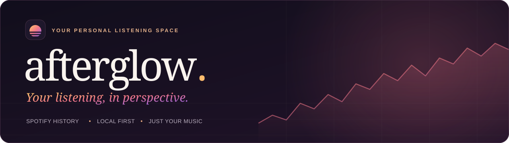
</p>

<p align="center">
  <strong>A little perspective on everything you listen to.</strong><br>
  Turn your Spotify export into a private, beautiful listening dashboard that runs entirely in your browser.
</p>

<p align="center">
  Local first &nbsp;·&nbsp; Try it with a demo &nbsp;·&nbsp; Generated cover art &nbsp;·&nbsp; No accounts &nbsp;·&nbsp; No build step
</p>

<p align="center">
  <a href="#a-look-inside">Screenshots</a> &nbsp;/&nbsp;
  <a href="#get-started">Get started</a> &nbsp;/&nbsp;
  <a href="#bring-your-history">Import your history</a> &nbsp;/&nbsp;
  <a href="#your-library-stays-yours">Privacy</a>
</p>

[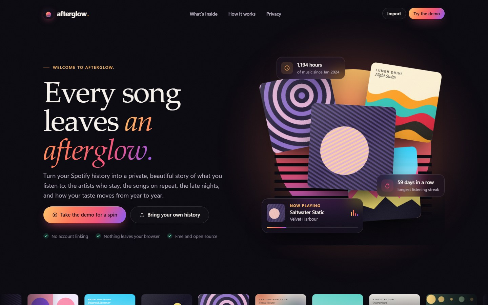](docs/screenshots/home.jpg)

## Your music has a story

The artist you always come back to. The song that took over a whole month. The late-night sessions that quietly became a habit. afterglow brings those patterns into view with warm gradients, detailed charts and a calm space to explore your history.

Open it and you land on a welcome page. **Take the demo for a spin** to explore a made-up listener's last three years of music, or **bring your own history** and it becomes yours.

| Explore | What you'll find |
| --- | --- |
| **The big picture** | Your #1 artist in the spotlight, hours, plays, artists and tracks, and a month-by-month listening story. |
| **Artists & albums** | Your podium, who's rising and who's fading, how concentrated your taste is, new discoveries and your top albums. |
| **Every track** | Search and sort every song you've ever played, with first listens and play counts. Export it all as CSV. |
| **Listening habits** | A year of days, a 24-hour listening clock, the shape of your week, sessions, skips, shuffle and offline plays. |
| **Year by year** | Hours, discoveries and days with music for each year, plus every year's favourite artist and track. |
| **Records & moments** | Your biggest day, longest streak, longest session, the song you couldn't stop replaying, and what you played on this day in earlier years. |

Click any artist, album or track for its own story. Press <kbd>Ctrl</kbd> <kbd>K</kbd> to find anything in your library.

<details>
<summary><strong>More of the homepage</strong></summary>
<br>

[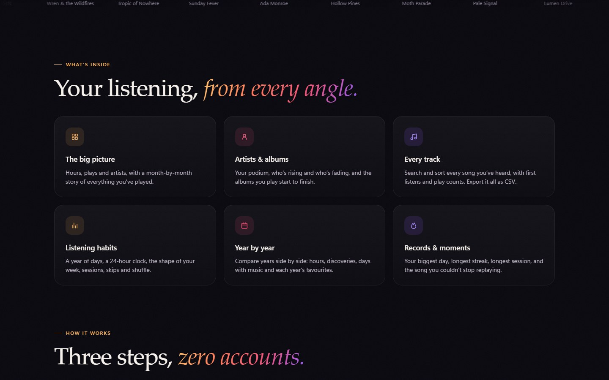](docs/screenshots/home-sections.jpg)

</details>

## A look inside

<table>
  <tr>
    <td width="50%">
      <a href="docs/screenshots/overview.jpg">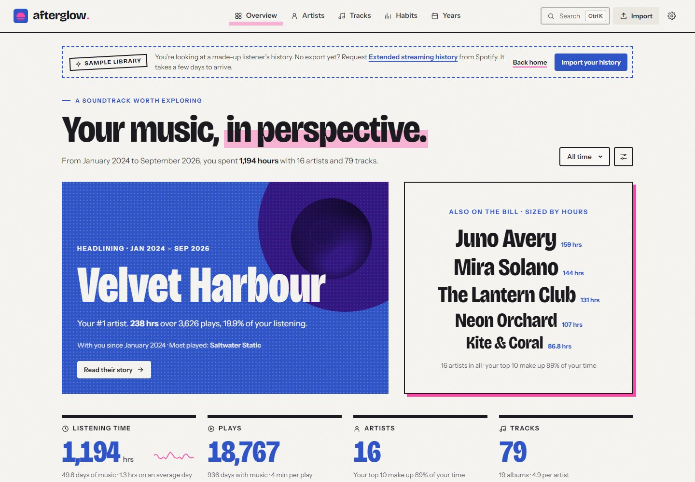</a>
      <br><strong>The big picture</strong><br>
      <sub>Your favourite artist lit by their own colours, and a month-by-month story.</sub>
    </td>
    <td width="50%">
      <a href="docs/screenshots/artists.jpg">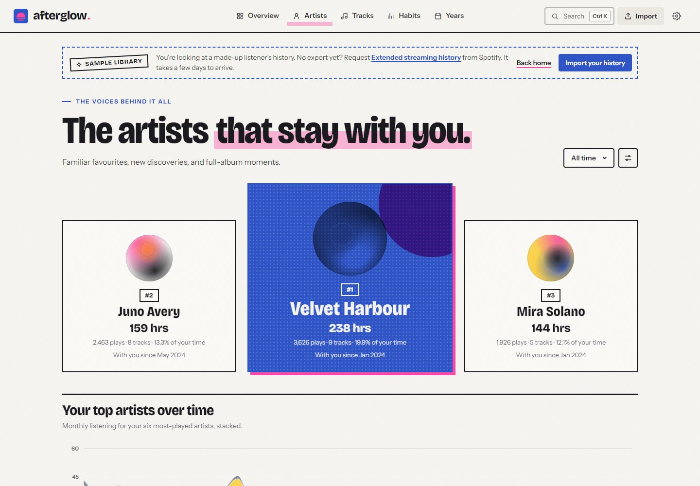</a>
      <br><strong>The voices behind it all</strong><br>
      <sub>Your podium, and how each favourite's place changes over time.</sub>
    </td>
  </tr>
  <tr>
    <td width="50%">
      <a href="docs/screenshots/albums.jpg">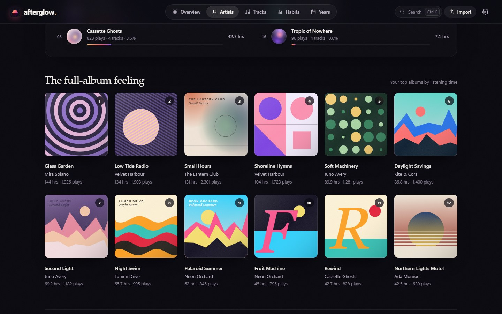</a>
      <br><strong>Made for the whole album</strong><br>
      <sub>Every album gets a cover, even in the demo.</sub>
    </td>
    <td width="50%">
      <a href="docs/screenshots/habits.jpg">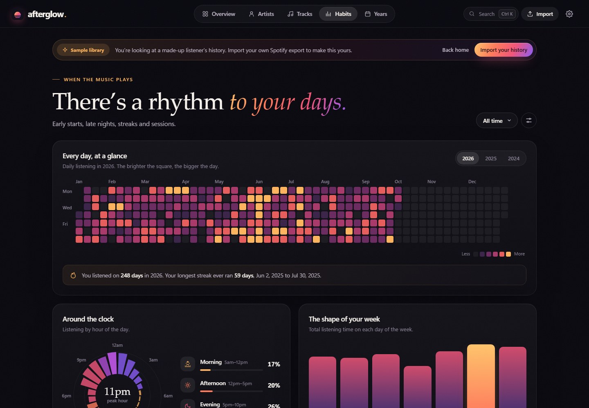</a>
      <br><strong>A rhythm to your days</strong><br>
      <sub>The hours, days and routines that have a soundtrack.</sub>
    </td>
  </tr>
  <tr>
    <td width="50%">
      <a href="docs/screenshots/artist-detail.jpg">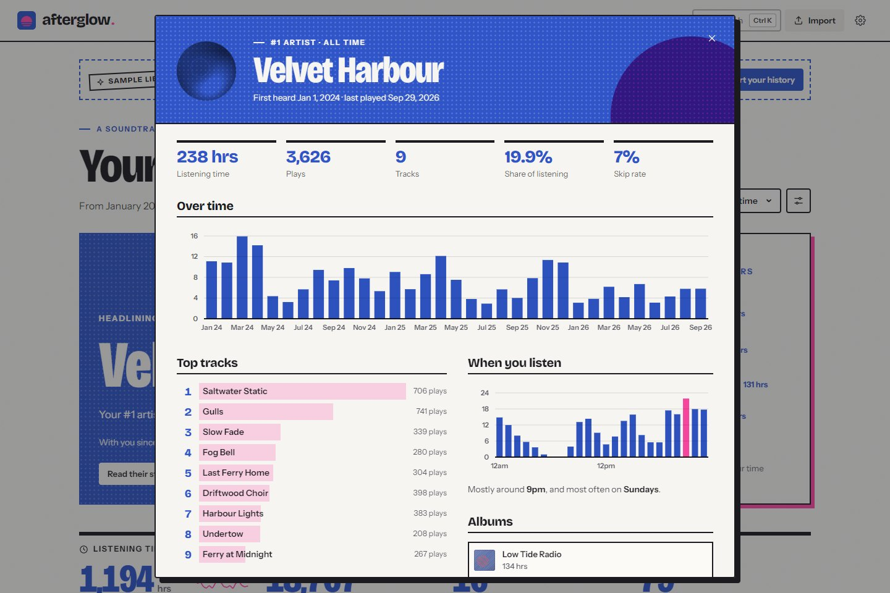</a>
      <br><strong>A closer look at a favourite</strong><br>
      <sub>Every artist, album and track opens into its own story.</sub>
    </td>
    <td width="50%">
      <a href="docs/screenshots/years.jpg">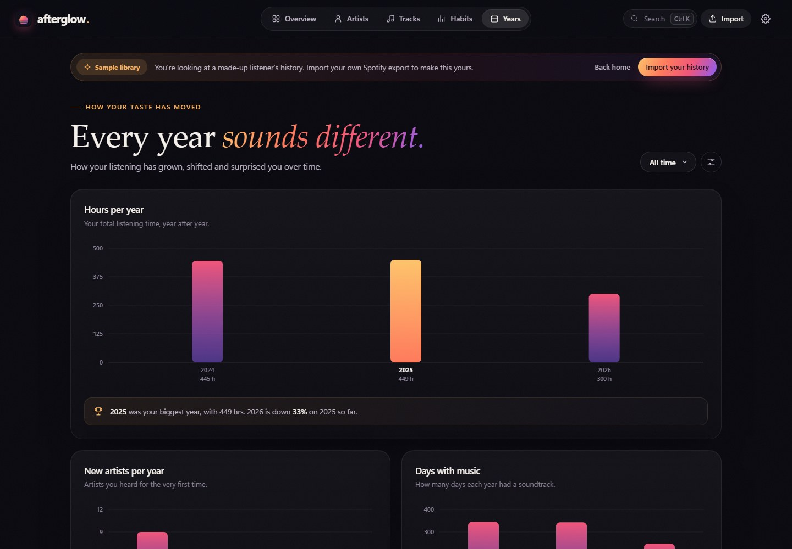</a>
      <br><strong>Every year sounds different</strong><br>
      <sub>How your listening has grown and shifted, year by year.</sub>
    </td>
  </tr>
  <tr>
    <td width="50%">
      <a href="docs/screenshots/tracks.jpg">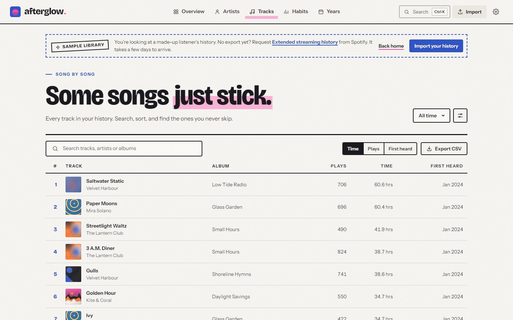</a>
      <br><strong>The songs on repeat</strong><br>
      <sub>Search, sort and export everything you've played.</sub>
    </td>
    <td width="50%">
      <a href="docs/screenshots/search.jpg">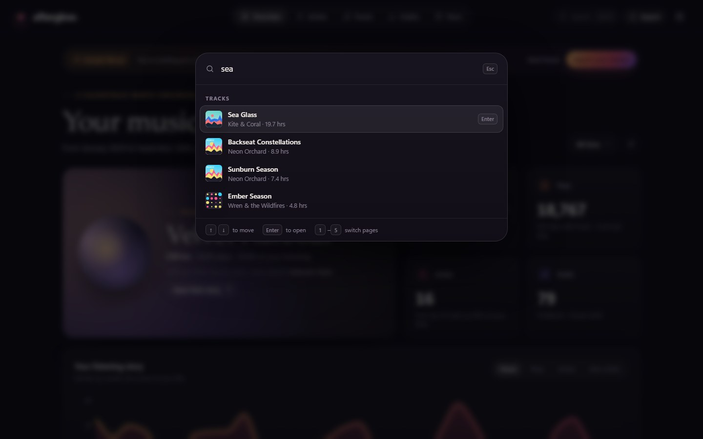</a>
      <br><strong>Find anything</strong><br>
      <sub>Artists, albums, tracks and pages, one keystroke away.</sub>
    </td>
  </tr>
</table>

<p align="center"><sub>Screenshots use the made-up sample library. Every artist, album, track and cover in it is fictional.</sub></p>

<details>
<summary><strong>Album pages, and afterglow on your phone</strong></summary>
<br>
<p align="center"><a href="docs/screenshots/album-detail.jpg">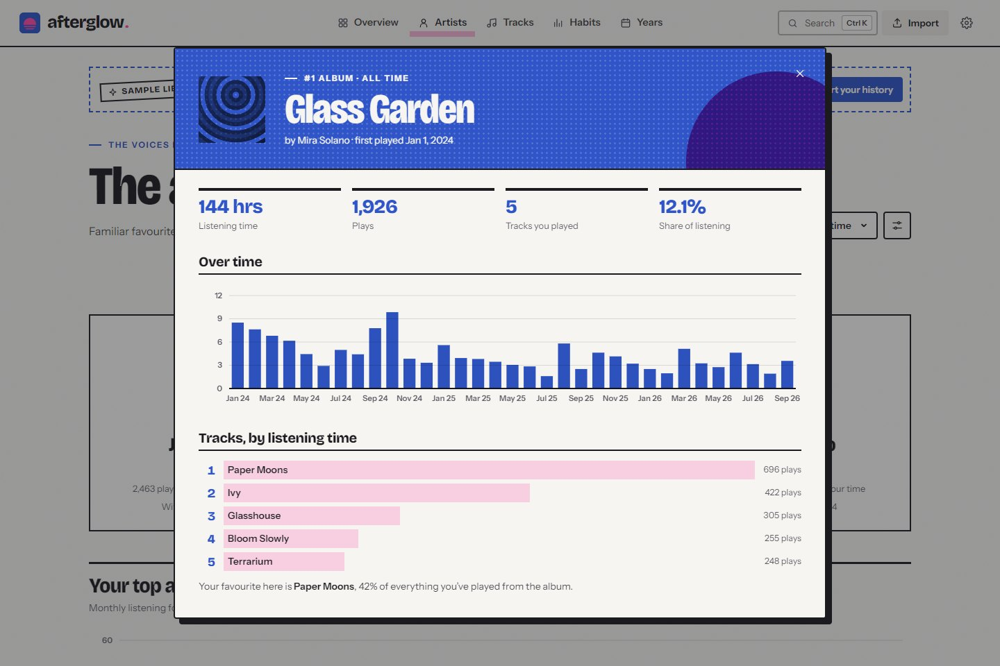</a></p>
<p align="center">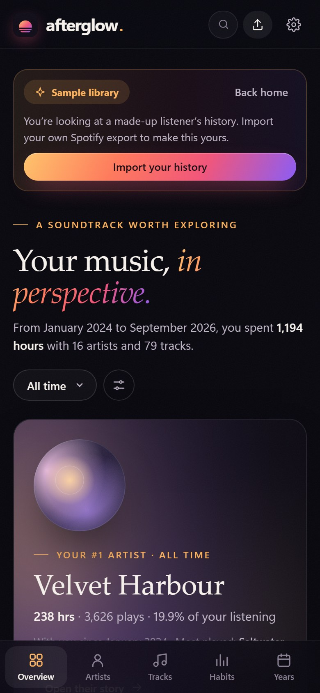</p>
</details>

## Get started

You'll need **Git** and **Node.js 22 or newer**. There's nothing to install: no packages, no build step.

```sh
git clone https://github.com/jasonfaeq/Afterglow.git
cd Afterglow
npm start
```

Open **[127.0.0.1:5173](http://127.0.0.1:5173/)** and you'll see the homepage. From there you can take the demo for a spin or import your own history. Stop the server with `Ctrl+C`. On Windows, `./start.ps1` does the same from PowerShell.

> Use the Node server rather than opening `index.html` directly. The app needs a real origin for its module worker and browser storage, and your library is saved per host and port.

## Bring your history

1. Request your data on **[Spotify's account privacy page](https://www.spotify.com/account/privacy/)**. Ask for **Extended streaming history** for the full picture.
2. Wait for Spotify's email and download the export.
3. Choose **Bring your own history** (or **Import**) and drop in the ZIP as it is, or the history JSON files inside it. All your years at once is fine.

| Export | What you get |
| --- | --- |
| `Streaming_History_Audio_*.json` | Extended history: tracks, artists, albums, track IDs, skips, shuffle and offline plays. |
| `StreamingHistory*.json` | Account data: tracks, artists and listening time. |
| The original ZIP | Supported history files are found inside nested folders and imported together. |

After an import you get a short welcome: your hours, your all-time #1 artist and track, and how far back your history goes. Importing more files later adds to your library. Exact duplicates are skipped, and re-importing the extended history fills in skip and shuffle details for plays you imported from the shorter export.

<details>
<summary><strong>Import limits</strong></summary>

ZIPs can use stored or deflate compression. Extract encrypted or ZIP64 archives first and import the JSON files.

- Largest input file: **500 MB**.
- Largest unpacked history file: **300 MB**, and **800 MB** in total per archive.

Larger exports can be extracted and imported as JSON in batches. Use a modern browser with module workers and IndexedDB.

</details>

## Cover art

The sample library is entirely made up, so every album gets its own **generated sleeve**: sunsets, rings, Bauhaus grids, mountain ridges, big italic letters. Artists get soft generated portraits. Your imported library uses the same art by default, so it never looks empty.

If you run afterglow with Spotify app credentials on the server (locally with `.env`, or on Vercel as environment variables), imported libraries can also show **real album covers and artist photos**. Nobody signs in to Spotify. Only names and track IDs are looked up, never your listening history, and real covers link back to Spotify. See the [cover art setup guide](docs/ARTWORK_SETUP.md). Settings → **Cover art & artist photos** turns lookups off at any time.

## Your library stays yours

**Your export is read on your device.** A background worker parses the files and computes every chart, and your library is saved in your browser's IndexedDB storage. There's no account, no backend database, no analytics, and no third-party fonts or scripts.

| Kept for your dashboard | Dropped during import |
| --- | --- |
| Track, artist, album, track ID, when each play ended, how long it played, and playback behaviour | Account details, IP addresses, location, platform and device fields, podcasts and audiobooks |

**Settings → Delete library** removes it from that browser. Your original export files aren't touched.

<details>
<summary><strong>How the numbers work</strong></summary>

- A play counts after **30 seconds** by default. Settings can count any length, or only plays over a minute. Skip and shuffle stats always include short plays, since most skips happen early.
- Rankings use **listening time**, not play counts.
- Tracks are grouped by title and artist. Each play is counted at the moment Spotify says it ended.
- A listening **session** is a run of plays with less than **30 minutes** of silence in between.
- Weeks start on Monday. Days, hours and years follow your device's time zone, or UTC if you choose it.
- The CSV export includes every track for the current year and play-length filters. Cells that look like spreadsheet formulas are escaped.

</details>

## Shortcuts

| Key | Does |
| --- | --- |
| <kbd>Ctrl</kbd> <kbd>K</kbd> or <kbd>/</kbd> | Search artists, albums, tracks and pages |
| <kbd>1</kbd> – <kbd>5</kbd> | Overview, Artists, Tracks, Habits, Years |
| <kbd>Esc</kbd> | Close a dialog |

## Under the hood

Plain HTML, CSS and JavaScript modules, SVG charts, a Web Worker and IndexedDB, served by a small dependency-free Node server.

```text
Spotify JSON / ZIP → worker → normalized plays → IndexedDB
                            ↘ stats for the page you're on

#/            homepage
#/demo/...    the made-up sample library
#/...         your own library
```

| Path | What it does |
| --- | --- |
| `server.mjs` | Serves `public/`, the artwork API and its request limits. |
| `server/static.mjs` | Static files only from `public/`: no dotfiles, traversal or unknown types. |
| `server/spotify-catalog.mjs` | Server-side catalog lookups: app token, shared cache and rate limits. |
| `public/index.html` | The homepage, the app shell and its dialogs. |
| `public/js/core.mjs` | Normalizing exports, merging imports, every statistic, the sample library and CSV. |
| `public/js/worker.mjs` | Reading JSON and ZIP files, storage, and keeping your library and the sample apart. |
| `public/js/main.mjs` | Routing, rendering, dialogs, import, settings and shortcuts. |
| `public/js/views/` | The homepage and the five dashboard pages. |
| `public/js/dialogs/` | Artist, album and track details, the import welcome, and search. |
| `public/js/ui/` · `public/js/lib/` | Charts, tooltips, shared components, formatting, icons and the generated cover art. |
| `public/js/artwork/` | Lazy, paced cover lookups in the browser and the rules shared with the server. |
| `public/css/` | Design tokens, the app shell, components, dialogs and the homepage. |

Run the tests with:

```sh
npm test
```

They use Node's built-in test runner and cover both export formats, private-field removal, duplicate and enriching imports, ZIP reading, filters, rankings, streaks, sessions, behaviour, artist/album/track details, "on this day", CSV escaping and the sample library. The artwork and server tests run against simulated Spotify responses and a real local HTTP server: credentials never leave the server, unknown fields are rejected, private files can't be fetched, and errors never leak provider responses.

---

<p align="center">
  <strong>afterglow.</strong><br>
  <sub>The songs you come back to. The artists that stay with you.</sub>
</p>
